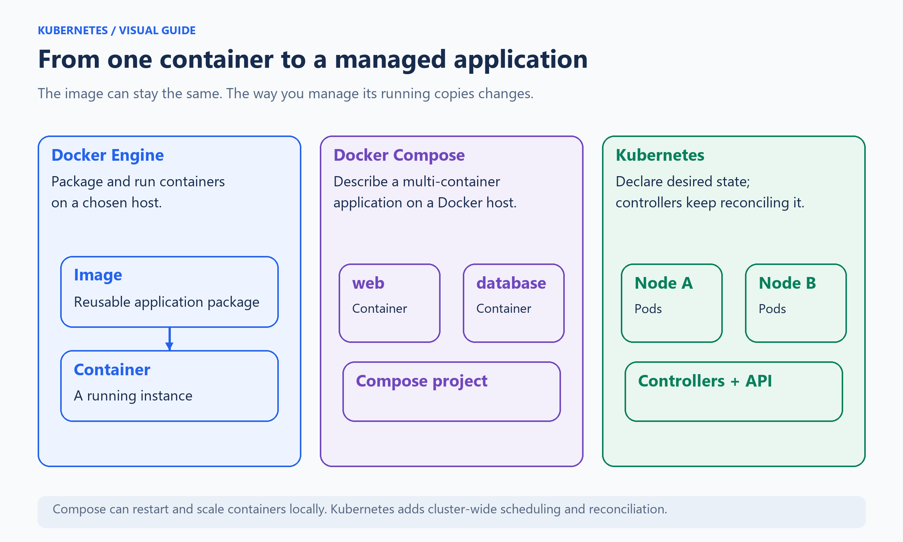
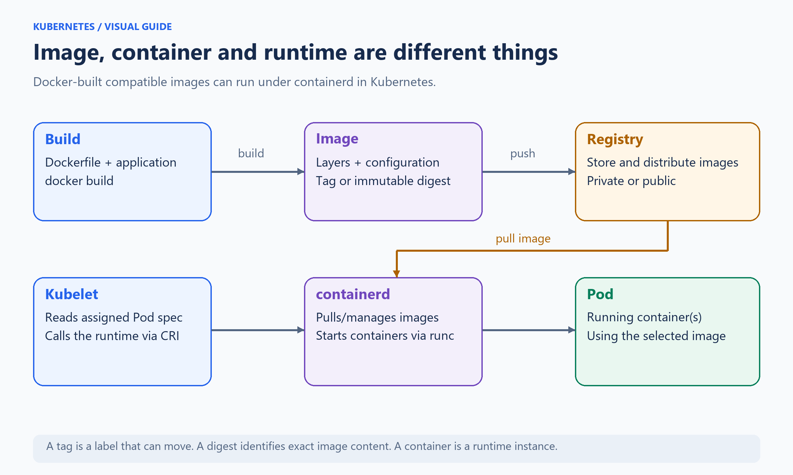
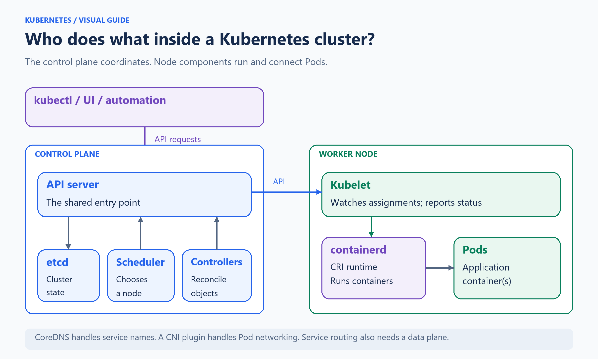
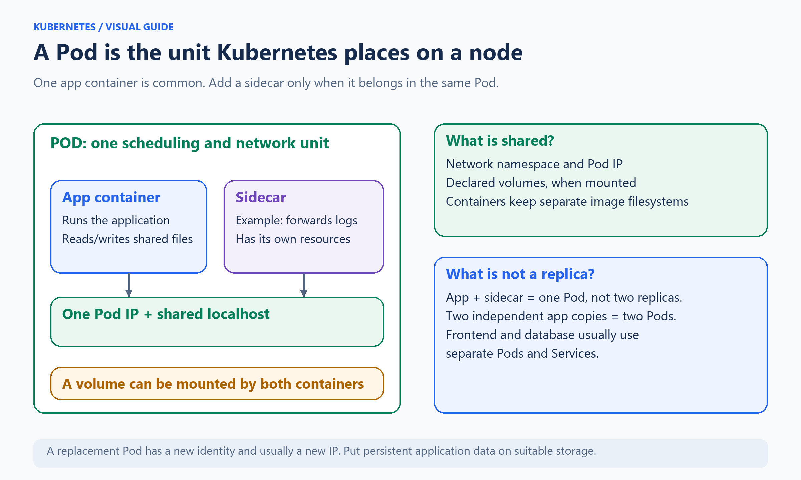
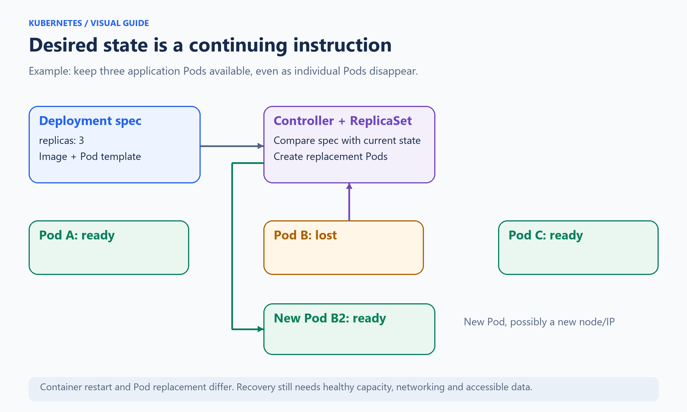
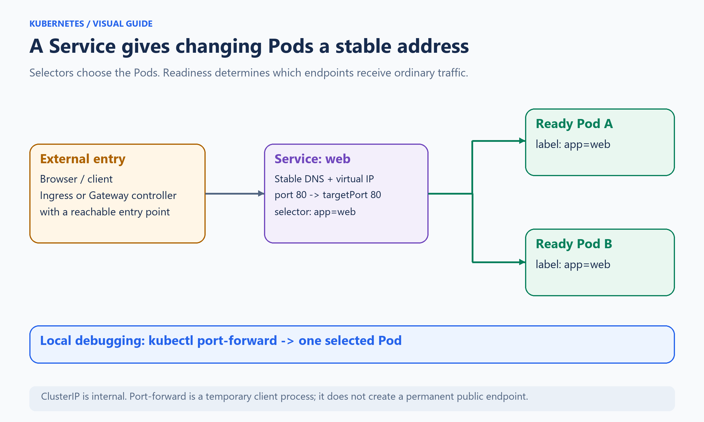
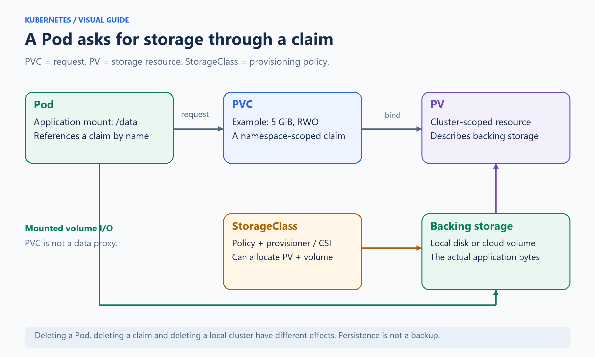
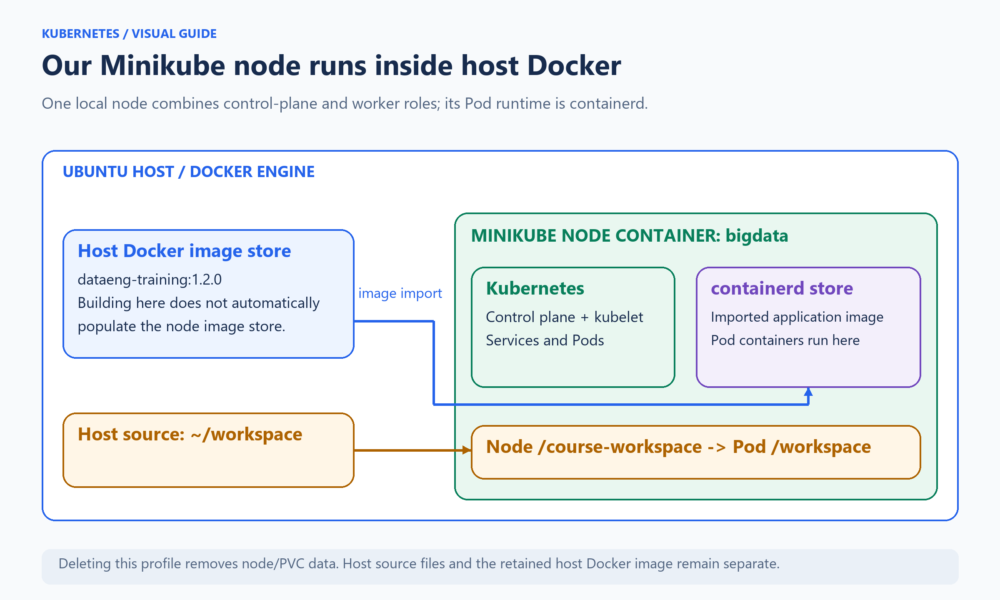
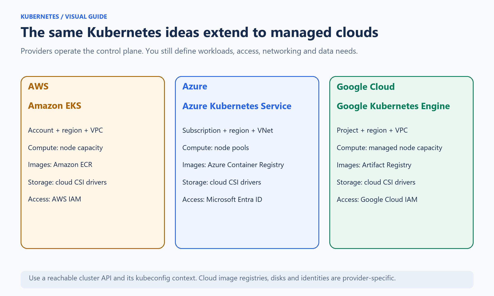

# 00 - Kubernetes introduction

Start with Docker, then Docker Compose, then Kubernetes. Keep the same application in mind: a web service that needs to stay available and a database that needs to keep its data.

This is a conceptual introduction with an optional small example. Read it before the [setup notebooks](../00-setup/00-ubuntu-workspace.ipynb). Open [the introduction notebook](00-kubernetes-introduction.ipynb) for the same illustrated lesson in Jupyter. Shell blocks are for an Ubuntu terminal, not a Python kernel. Nothing in this introduction has been deployed automatically.

**Reading route:** Docker/Compose (01-04), cluster and workloads (05-10), networking/storage (11-15), operations (16-20), Minikube/example (21-23), clouds (24-28), recap/setup (29-30).

The diagrams use blue for configuration/control, green for running workloads/data, purple for runtime/service abstractions and amber for infrastructure choices. Read each image from its labelled boxes and arrows; the text below explains its meaning.

## 01 - Why Kubernetes, when we already have Docker?

Docker makes an application portable by packaging its files and dependencies into an image and running a container from that image. Docker Compose describes several related containers, their configuration, networks and volumes in YAML. It is useful for development, testing and production applications on a chosen Docker host.

Now ask a larger question: **Where should three copies of the application run, and what should happen if a machine fails?** Kubernetes manages that continuing desired state across a cluster. It schedules Pods, watches their condition and coordinates replacement, networking and storage resources.



**Read the image:** the application package can remain the same while the management layer changes. Compose gives a convenient application description. Kubernetes adds a cluster API and controllers that keep working after the original command finishes.

Compose supports restart policies and scaling; it is not limited to manually starting one container. Kubernetes becomes useful when you need cluster scheduling, consistent service discovery, controlled rollout and many independently managed workloads. A small application on one host may be simpler with Compose.

Sources: [Docker Compose use cases](https://docs.docker.com/compose/intro/features-uses/), [Kubernetes concepts](https://kubernetes.io/docs/concepts/).

## 02 - Docker, Compose and Kubernetes side by side

| Question | Docker Engine | Docker Compose | Kubernetes |
|---|---|---|---|
| What do I describe? | A container and its run options | A multi-container application | API objects and desired state |
| Main description | Dockerfile builds an image; run options start it | `compose.yaml` | YAML manifests, often several objects |
| Main command | `docker run` | `docker compose up` | `kubectl apply` |
| Normal placement | The Docker host you choose | A chosen Docker host | A scheduler chooses suitable nodes |
| Application copy | Container instance | Container instance for a Compose service | Usually a Pod managed by a controller |
| Networking | Published ports and Docker networks | Service names on Compose networks | Pod networking, Services and cluster DNS |
| Persistence | Volume or bind mount | Named volume or bind mount | Pod volumes, PVC/PV and StorageClass |
| Recovery | Container restart policy | Restart policies; app lifecycle commands | Kubelet restarts and controller reconciliation |
| Updates | Replace/recreate the container | Recreate changed services | Controlled controller rollouts |
| More capacity | Add capacity to the chosen host or another orchestration layer | Scale services within available host capacity | Add nodes and/or increase Pod replicas |

These are relationships, not exact translations. A **Compose service** is a container configuration. A **Kubernetes Service** is a networking object; it does not start the application. Docker also has Swarm, a separate orchestration option outside this introduction.

Compose `depends_on` can express ordering and health conditions. Kubernetes has no universal equivalent that makes every application dependency ready in order: use readiness, init containers where appropriate, application retries and explicit setup steps. Creating YAML files in a particular order alone does not prove readiness.

Source: [Compose service configuration](https://docs.docker.com/reference/compose-file/services/).

## 03 - Image, container, registry and runtime

An **image** is a reusable application package: filesystem layers and configuration such as the startup command. A **container** is a running instance with its own process environment and writable layer. Many containers can use the same image.

A **Dockerfile** describes image construction. A **registry** stores and distributes images. A **repository** holds related images; a **tag** is a readable label such as `1.2.0`. A **digest** identifies exact image content. Tags can be moved; a digest is the stronger reference for repeatability.



**Read the image:** build and distribution are the upper row. Running assigned workloads is the lower row. Building an image is different from starting a container, and neither operation creates a Kubernetes cluster.

An image does not contain a running process or a full separate Linux kernel. Linux containers share the node's kernel while operating with isolation and resource controls. Put changing application data on suitable storage instead of assuming the container's writable layer will survive replacement. The image platform must also be compatible with the node operating system and CPU architecture.

`imagePullPolicy` controls image availability behaviour: `IfNotPresent` can reuse a local image, `Always` resolves the reference when starting (matching layers may still be cached), and `Never` requires the image to be present locally.

Sources: [Docker container execution](https://docs.docker.com/engine/containers/run/), [Kubernetes images](https://kubernetes.io/docs/concepts/containers/images/).

## 04 - containerd, Docker Engine and the CRI

**Docker Engine** offers the familiar Docker API and commands. It uses runtime components, including containerd, underneath. **containerd** manages images and container lifecycle. A lower-level runtime such as **runc** creates and runs the isolated Linux container process.

Kubernetes node software talks to a runtime through the **Container Runtime Interface (CRI)**. containerd supports CRI. CRI-O is another option. Kubernetes can therefore run compatible Docker-built images without requiring Docker Engine as the node's CRI runtime.

The old built-in Docker Engine integration, dockershim, was removed in Kubernetes 1.24. This did not make Docker-built images unusable. Docker Engine can still be integrated through an additional CRI adapter; our course uses containerd inside the Minikube node.

Remember the two relationships:

```text
Building: Dockerfile -> docker build -> image -> registry or local image store
Running:  kubelet -> CRI -> containerd -> low-level runtime -> container
```

Source: [Kubernetes container runtimes](https://kubernetes.io/docs/setup/production-environment/container-runtimes/).

## 05 - Cluster, node and control plane

A **cluster** is the Kubernetes management system plus the nodes that provide workload capacity. A **node** is a machine, normally a VM or physical host, registered with the cluster. Local tools can run node environments inside containers.

The **control plane** coordinates the cluster. The **worker role** runs application Pods. Roles can share a machine in a local learning setup. A production topology commonly separates them and provides redundancy.



**Read the image:** the API server is the shared entry point. The scheduler chooses a node; the kubelet on that node works with its runtime to run the assigned Pod. etcd is cluster-state storage, not the database for your application's business records.

| Component | Simple responsibility |
|---|---|
| API server | Receives API requests and exposes cluster objects |
| etcd | Stores Kubernetes state used by the control plane |
| Scheduler | Selects a suitable node for an unscheduled Pod |
| Controller manager | Runs controllers that reconcile objects |
| Cloud controller manager | Integrates cloud-specific infrastructure when applicable |
| Kubelet | Node agent that works to run assigned Pod containers |
| Container runtime | Manages images and container execution |
| CoreDNS | Resolves cluster Service names |
| CNI network plugin | Implements Pod networking |
| Service data plane | Routes Service traffic; commonly kube-proxy or a replacement |

Sources: [Components](https://kubernetes.io/docs/concepts/overview/components/), [Nodes](https://kubernetes.io/docs/concepts/architecture/nodes/).

## 06 - What a Pod actually contains

A **Pod** is the smallest workload unit Kubernetes schedules. It contains one or more containers with a shared network context and declared volumes. One main application container is common. A closely related helper can be a **sidecar**, such as a log forwarder.



**Read the image:** app and sidecar are still one Pod, not two application replicas. They can communicate through `localhost` and mount the same declared volume. They keep separate image filesystems and can have separate resource settings.

An **init container** performs preparation before ordinary app containers start. An **ephemeral debug container** helps investigate an existing Pod. Do not put unrelated frontend, database and queue servers into one Pod simply to reproduce a Compose file: they usually need independent scaling and lifecycle.

A replacement Pod has a new identity and usually a new IP. A container restart within the same Pod is a different event. A sidecar collecting file logs needs the relevant shared mount and correct file paths; collecting container stdout does not automatically discover every application log file.

Sources: [Pods](https://kubernetes.io/docs/concepts/workloads/pods/), [Sidecars](https://kubernetes.io/docs/concepts/workloads/pods/sidecar-containers/), [Init containers](https://kubernetes.io/docs/concepts/workloads/pods/init-containers/).

## 07 - Desired state, controllers and recovery

In Kubernetes you describe a continuing goal: for example, **run three application replicas**. A controller compares that goal with the observed state and takes steps to close the gap. This repeated work is called **reconciliation**.



**Read the image:** when Pod B disappears, its controller can arrange a replacement. The new Pod is not the same process with the same IP. A stable Service lets clients continue using a consistent application address.

Recovery depends on the workload's controller, usable node capacity, available images, networking and accessible storage. The kubelet can restart a failed container according to its restart policy. Controllers can create replacement Pods; the scheduler then finds a suitable node. A directly created standalone Pod has no Deployment controller to maintain a desired replica count.

One local node cannot provide another machine during a host failure. Replicas on one machine help with some process failures but do not create machine-level availability. Database recovery also depends on its own data and replication design.

Sources: [Controllers](https://kubernetes.io/docs/concepts/architecture/controller/), [Pod lifecycle](https://kubernetes.io/docs/concepts/workloads/pods/pod-lifecycle/).

## 08 - Choose the right workload object

| Object | Use it for | Familiar example |
|---|---|---|
| Deployment | Replaceable application replicas and rollouts | Web API or a stateless worker |
| ReplicaSet | Maintaining a replica count; normally managed by a Deployment | The Pods behind an app release |
| StatefulSet | Stable Pod identities and per-replica storage patterns | A stateful database/server topology |
| DaemonSet | A Pod on each eligible node | Node-level logging or networking agent |
| Job | Work that should finish successfully | Schema initialization or batch task |
| CronJob | Scheduled Jobs | A periodic report or maintenance task |

A Deployment is a good first controller to understand. A StatefulSet adds stable identities and storage relationships; it does not automatically turn a database into a replicated, backed-up, highly available database. Jobs have completion/failure behaviour rather than an always-running server goal. DaemonSets follow eligible nodes rather than a normal fixed app replica count.

Sources: [Deployments](https://kubernetes.io/docs/concepts/workloads/controllers/deployment/), [StatefulSets](https://kubernetes.io/docs/concepts/workloads/controllers/statefulset/), [Jobs](https://kubernetes.io/docs/concepts/workloads/controllers/job/), [DaemonSets](https://kubernetes.io/docs/concepts/workloads/controllers/daemonset/).

## 09 - Namespaces, labels and selectors

A **namespace** groups namespaced resources. For example, two namespaces can each have a Service called `web`. Nodes, PersistentVolumes and StorageClasses are cluster-scoped rather than belonging to one namespace.

Namespaces provide organisation and a scope for access and resource policies. They are not separate physical clusters or automatic network/security boundaries.

**Labels** identify relationships, such as `app: web` or `component: kafka`. A **selector** matches labels. A Service selector chooses matching Pods; a controller selector connects it to its intended Pods. **Annotations** carry additional metadata that is not used as the normal label selector.

```yaml
# Pod template label
metadata:
  labels:
    app: web

# Matching Service selector
spec:
  selector:
    app: web
```

These fragments illustrate different object fields, not one complete manifest. A label mismatch can leave a Service with no application endpoints even while Pods are running.

Sources: [Namespaces](https://kubernetes.io/docs/concepts/overview/working-with-objects/namespaces/), [Labels and selectors](https://kubernetes.io/docs/concepts/overview/working-with-objects/labels/).

## 10 - Read a Kubernetes YAML object

The main fields answer five simple questions:

| Field | Question |
|---|---|
| `apiVersion` | Which API group/version defines this resource? |
| `kind` | What type of object is this? |
| `metadata` | What is its name, namespace and identifying metadata? |
| `spec` | What desired configuration do I request? |
| `status` | What does the system currently observe? Usually system-maintained. |

For a Deployment, its `spec.template` describes the Pods it should create. YAML indentation changes structure; names and selectors must agree. A file can contain several objects separated by `---`.

`kubectl apply` submits desired configuration through the API. It does not wait for every application dependency to become ready and does not mean the app is usable immediately. Inspect rollout/readiness and test the real application operation.

Keep authored desired-state files in version control. Raw live exports can contain generated fields such as `status`, UIDs and managed fields; review them before treating them as reusable source.

Sources: [API objects](https://kubernetes.io/docs/concepts/overview/working-with-objects/), [The Kubernetes API](https://kubernetes.io/docs/concepts/overview/kubernetes-api/).

## 11 - Pod networking, Services and DNS

Pods have network addresses, but those addresses can change after replacement. A **Service** provides a stable discovery point for matching Pods. **CoreDNS** provides names for Services. In the usual default cluster domain, `web.kube-intro.svc.cluster.local` refers to Service `web` in namespace `kube-intro`.



**Read the image:** Service selection and readiness connect a stable application address to suitable Pod endpoints. The application still needs to listen on the target port.

| Service type | Typical purpose |
|---|---|
| ClusterIP | Internal cluster access; the normal default |
| NodePort | Expose a port on nodes; requires node reachability |
| LoadBalancer | Request an external load balancer from an available implementation |
| Headless Service | DNS discovery without the usual Service virtual IP; often useful for stateful peers |

`port` is the Service port. `targetPort` is the application port in the Pod. `nodePort`, when used, is a node-facing port. Declaring `containerPort` alone does not publish a container to the outside world.

Source: [Services](https://kubernetes.io/docs/concepts/services-networking/service/).

## 12 - Ingress, Gateway and port-forward

**Ingress** describes HTTP/HTTPS routing and needs an Ingress controller. **Gateway API** offers a newer set of routing resources and also needs a compatible implementation. Creating a routing object by itself does not install the controller or guarantee external reachability. HTTPS also requires the appropriate certificate and TLS configuration.

For local exploration, `kubectl port-forward` creates a temporary tunnel from the terminal machine to a selected Pod. When you target a Service, kubectl selects a backing Pod; this is not a test of ordinary Service load balancing. It ends when the process or selected Pod ends, so it is not a permanent public deployment endpoint.

There is no general Service YAML field equivalent to a Compose `ports: ["8088:80"]` that creates a localhost client tunnel. A NodePort, a LoadBalancer and a foreground port-forward solve different access problems.

In the course, use the browser on the Ubuntu desktop reached through Guacamole. `127.0.0.1` refers to that Ubuntu machine when its browser is running there. Headlamp's Minikube URL and the optional localhost forwards are explained in the setup notebooks.

Sources: [Ingress](https://kubernetes.io/docs/concepts/services-networking/ingress/), [Gateway API](https://kubernetes.io/docs/concepts/services-networking/gateway/), [kubectl port-forward reference](https://kubernetes.io/docs/reference/kubectl/generated/kubectl_port-forward/).

## 13 - Storage from container files to persistent data

Storage has several different lifetimes:

| Storage location | What it is useful for | What to remember |
|---|---|---|
| Container writable layer | Temporary local files | Recreated containers do not retain this layer as persistent application storage |
| `emptyDir` | Shared temporary files within a Pod | Survives container restarts in that Pod; disappears with the Pod |
| `hostPath` | Access to a node path | Tied to that node and its security/availability |
| Persistent volume | Data that must outlive ordinary Pod replacement | Behaviour depends on backing storage, claims and policies |
| Object storage such as S3 | Objects accessed using an object-store API | Not automatically a POSIX filesystem mount or a Kubernetes PV |

An application mount path such as `/data` tells the process where it sees files. It does not tell you where the physical bytes are stored. Determine which volume is mounted there and what backs it.

In Compose, a named Docker volume is attached directly through the Compose configuration. Kubernetes separates the application's storage request from the cluster's storage resource and provisioning policy.

Source: [Kubernetes volumes](https://kubernetes.io/docs/concepts/storage/volumes/).

## 14 - PVC, PV, StorageClass and CSI



**Read the image:** the upper arrows describe object references and binding. The bottom route represents mounted storage I/O. The PVC is not a proxy that receives application file writes.

| Term | Plain meaning |
|---|---|
| PVC: PersistentVolumeClaim | A namespaced request for suitable storage |
| PV: PersistentVolume | A cluster storage resource bound to a claim |
| StorageClass | A named provisioning policy, such as a type of disk |
| CSI: Container Storage Interface | A standard interface used by storage drivers |
| Dynamic provisioning | Allocating storage when a suitable claim requires it |

Access modes express mounting capabilities. **RWO** usually means read/write from one node, not necessarily one Pod. **RWX** permits read/write from multiple nodes when the storage supports it. **RWOP** restricts read/write access to one Pod with supported CSI storage. Capacity, access mode, topology and class need to match the workload.

Sources: [PersistentVolumes and claims](https://kubernetes.io/docs/concepts/storage/persistent-volumes/), [StorageClasses](https://kubernetes.io/docs/concepts/storage/storage-classes/).

## 15 - Storage deletion, retention and backup

Compare three separate operations:

1. **Replace a Pod:** a persistent claim can keep providing the same application storage.
2. **Delete a PVC:** a PV's reclaim policy and storage behaviour determine whether the backing data is retained or deleted.
3. **Delete a local Minikube profile:** node-local PVC data can disappear with the node environment, even though the source folder on the Ubuntu host remains.

`Delete` and `Retain` are different PV reclaim policies. StatefulSet PVC retention behaviour also depends on its configured policy and what you delete. Do not infer deletion behaviour just from the word "persistent".

Persistence across Pod replacement is not a backup. A backup should allow recovery from lost/corrupted data and should be tested. Volume snapshots need suitable CSI support and do not by themselves guarantee an application-consistent database backup. A restored database also needs compatible metadata, credentials and application expectations.

Source: [Volume snapshots](https://kubernetes.io/docs/concepts/storage/volume-snapshots/); use the PV/StatefulSet references above for their lifecycle policies.

## 16 - Configuration, Secrets and application identity

A **ConfigMap** holds non-sensitive configuration, such as properties or an endpoint name. A **Secret** holds sensitive values, such as a password or token. Containers can consume these through environment variables or mounted files.

Base64 encoding of Secret values is not encryption. Restrict access and use suitable protection for stored secrets. Do not put real access tokens, private keys or production passwords in notebooks or Git. Public example credentials in a local demonstration are a different purpose from production credentials.

Changing a ConfigMap/Secret does not guarantee that the application has reloaded it. Environment variables do not update inside an already running process. Mounted-file updates have their own behaviour, and the application still needs to read/reload them; `subPath` mounts have additional limitations. Design reload or rollout deliberately.

A **ServiceAccount** gives a workload an API identity. It does not automatically grant every permission. Cloud workload identity is another layer: a Pod's Kubernetes identity is connected to an authorised cloud identity using the provider's mechanism.

Sources: [ConfigMaps](https://kubernetes.io/docs/concepts/configuration/configmap/), [Secrets](https://kubernetes.io/docs/concepts/configuration/secret/).

## 17 - Scheduling and resource requests/limits

A **request** declares the resources used for scheduling and allocation decisions. A **limit** bounds resource use according to the resource type. `100m` CPU means one tenth of a CPU; `1` means one CPU. `Mi` and `Gi` are binary memory units.

```yaml
resources:
  requests:
    cpu: 100m
    memory: 128Mi
  limits:
    cpu: 500m
    memory: 256Mi
```

CPU limits can lead to throttling. Exceeding a memory limit can lead to an OOM kill. A Pod can be Pending when nodes cannot satisfy its requests or other placement constraints, even if a process appears to use little memory right now.

Node selectors/affinity express placement preferences or requirements. Taints and tolerations affect which Pods can use particular nodes. Storage topology can restrict placement too. On a small Minikube node, stage heavy services rather than asking the scheduler for more capacity than exists.

Source: [Resource management](https://kubernetes.io/docs/concepts/configuration/manage-resources-containers/).

## 18 - Health checks and controlled updates

| Probe | Question | Typical consequence of failure |
|---|---|---|
| Startup | Has the slow-starting application started? | Protects startup time; failure can trigger restart |
| Readiness | Should this Pod receive normal Service traffic? | Pod is not treated as a ready endpoint |
| Liveness | Is the application stuck/unhealthy in a way restart can help? | Container restart after the configured failure threshold |

A Running Pod is not automatically a ready or useful application. A database process can be running while schema preparation is unfinished. Check the workload operation as well as Kubernetes readiness.

For a Deployment update, the controller creates a new ReplicaSet and coordinates old/new Pods according to rollout settings. `kubectl rollout status` observes progress; rollback can restore a prior Pod template, but does not undo database migrations or data corruption. Allow enough healthy capacity for the update strategy.

Source: [Probe behaviour](https://kubernetes.io/docs/tasks/configure-pod-container/configure-liveness-readiness-startup-probes/); see the Deployment reference for rollout behaviour.

## 19 - Scaling, security and the next layer of concepts

| Concept | What to understand first |
|---|---|
| Horizontal Pod Autoscaler | Changes eligible workload replicas using available metrics |
| Node autoscaling | Changes node capacity; different from changing Pod replicas |
| PodDisruptionBudget | Limits some voluntary disruptions; does not prevent every failure |
| RBAC | Roles and bindings control allowed Kubernetes API actions |
| NetworkPolicy | Controls selected Pod traffic with a supporting network implementation |
| Security context | Container/Pod execution identity and security settings |
| ResourceQuota / LimitRange | Namespace-level capacity and default/boundary rules |
| CRD / operator | Extends the API / adds domain-specific controllers |
| Helm / Kustomize | Package or customise manifests; Kubernetes still runs the resulting objects |

Autoscaling needs the appropriate controllers and metrics; Kubernetes does not invent more physical RAM. RBAC answers API permission questions, while NetworkPolicy addresses network traffic. Namespaces alone replace neither. A NetworkPolicy needs a network implementation that enforces it.

Sources: [Autoscaling](https://kubernetes.io/docs/concepts/workloads/autoscaling/), [RBAC practices](https://kubernetes.io/docs/concepts/security/rbac-good-practices/), [NetworkPolicy](https://kubernetes.io/docs/concepts/services-networking/network-policies/).

## 20 - Logs, metrics, traces and troubleshooting

These answer different questions:

| Signal | Example question | Course tooling |
|---|---|---|
| Logs | What happened or what error was reported? | Alloy -> Loki -> Grafana |
| Metrics | How much CPU/memory or JVM heap is being used? | Prometheus -> Grafana |
| Traces | Which instrumented steps formed one request? | Jaeger |
| Events | Why could Kubernetes not schedule or start a Pod? | kubectl / Headlamp |

Start monitoring before the application so first-start logs are collected. Container stdout and application files are different log sources; collecting both may require a shared file mount and a forwarding sidecar. Traces require instrumentation; installing Jaeger alone does not make every application emit traces.

Pod phases such as Pending and Running differ from container waiting reasons such as ImagePullBackOff or CrashLoopBackOff. Read the detailed status and events rather than relying on one displayed word.

| Symptom | First things to inspect |
|---|---|
| Pending | Events, requests, node capacity, PVC binding and placement constraints |
| ImagePullBackOff | Image name/tag, registry reachability and pull permission |
| CrashLoopBackOff | Container logs, previous attempt, command/config and probes |
| Running but not ready | Readiness checks and actual dependency/application state |
| OOMKilled | Memory settings and application memory use |
| Service has no useful response | Labels/endpoints, readiness and listening target port |

Source: [Debugging Pods](https://kubernetes.io/docs/tasks/debug/debug-application/debug-pods/). The course monitoring implementation is in [02-monitoring.ipynb](../00-setup/02-monitoring.ipynb).

## 21 - Minikube and our two image stores

Minikube creates local Kubernetes environments. It can use different drivers and can create multiple nodes. Our initial setup uses one Docker-driver node, with containerd as the Pod runtime.



**Read the image:** host Docker runs the Minikube node container. Inside that node, Kubernetes/containerd runs Pod containers. Therefore the host Docker image store and node containerd image store are separate. Host `docker ps` does not list each Kubernetes application Pod as an ordinary host Docker container.

The host project is `~/workspace` by default, or your chosen `WORKSPACE_HOME`. The course mounts it as `/course-workspace` in the node and `/workspace` in Jupyter. This host source mount is different from database/PVC storage inside the node.

A convenient generic image-loading command is `minikube -p bigdata image load IMAGE`. Notebook 08 shows the course's validated Docker-export/containerd-import procedure and reuses an existing image when available. An image available on your laptop is not automatically available to a different Ubuntu host or a cloud node.

Sources: [Minikube Docker driver](https://minikube.sigs.k8s.io/docs/drivers/docker/), [Minikube image loading](https://minikube.sigs.k8s.io/docs/handbook/pushing/).

## 22 - Follow one request through the cluster

For a Deployment requesting two web Pods, the sequence is:

1. `kubectl` sends the authored objects to the API server.
2. The API accepts valid objects and stores cluster state.
3. The Deployment/ReplicaSet controllers arrange the required Pods.
4. The scheduler assigns unscheduled Pods to suitable nodes.
5. Each node's kubelet works through its runtime to run the containers; images must be available.
6. Networking and configured volume mounts make the Pod's environment usable.
7. Readiness identifies usable application endpoints; a matching Service provides discovery/routing.
8. Controllers keep observing and reconciling as conditions change.

This is a simplified explanation of interacting control loops, not a guarantee that every action occurs as one synchronous transaction. `kubectl apply` returning successfully is the beginning of the application readiness check.

After setup, useful read-only inspection commands are:

```bash
kubectl --context=bigdata get nodes
kubectl --context=bigdata get pods -A
kubectl --context=bigdata -n bigdata get services,pvc
kubectl --context=bigdata -n bigdata get events --sort-by=.metadata.creationTimestamp
kubectl --context=bigdata -n bigdata top pods
kubectl --context=bigdata explain deployment.spec
```

Use explicit context/namespace when you are connected to more than one cluster. `kubectl top` needs a resource metrics API such as metrics-server; it is different from querying Prometheus history.

## 23 - Optional example: the same web image in Compose and Kubernetes

Run this only after the [Minikube setup](../00-setup/01-minikube-cluster.ipynb), when you deliberately want the small exercise. The two examples are alternatives. Stop Compose before reusing local port 8088 for Kubernetes. The example uses the readable, mutable `nginx:stable-alpine` tag; use a verified version/digest for a reproducible release.

**Compose description** - save as `compose.yaml` in a separate demo directory:

```yaml
services:
  web:
    image: nginx:stable-alpine
    ports:
      - "127.0.0.1:8088:80"
    restart: unless-stopped
```

```bash
docker compose up -d
curl -fsS http://127.0.0.1:8088
docker compose down
```

Compose starts the configured container and publishes its port. The next version uses the same image but asks a Deployment for two Pods and gives them a Service.

**Kubernetes description** - paste the whole block into your Ubuntu terminal:

```bash
kubectl --context=bigdata apply -f - <<'YAML'
apiVersion: v1
kind: Namespace
metadata:
  name: kube-intro
---
apiVersion: apps/v1
kind: Deployment
metadata:
  name: web
  namespace: kube-intro
spec:
  replicas: 2
  selector:
    matchLabels:
      app: web
  template:
    metadata:
      labels:
        app: web
    spec:
      containers:
      - name: web
        image: nginx:stable-alpine
        ports:
        - name: http
          containerPort: 80
        resources:
          requests:
            cpu: 50m
            memory: 64Mi
          limits:
            cpu: 250m
            memory: 128Mi
        readinessProbe:
          httpGet:
            path: /
            port: http
          periodSeconds: 5
---
apiVersion: v1
kind: Service
metadata:
  name: web
  namespace: kube-intro
spec:
  selector:
    app: web
  ports:
  - name: http
    port: 80
    targetPort: http
YAML
```

Wait and inspect in the original terminal:

```bash
kubectl --context=bigdata -n kube-intro rollout status deployment/web --timeout=180s
kubectl --context=bigdata -n kube-intro get deployment,replicaset,pods,service
kubectl --context=bigdata -n kube-intro get endpointslices -l kubernetes.io/service-name=web
```

Open **a second terminal** and keep it open:

```bash
kubectl --context=bigdata -n kube-intro port-forward --address=127.0.0.1 service/web 8088:80
```

In the original terminal, check the page:

```bash
curl -fsS http://127.0.0.1:8088
```

Expected: two ready Pods and an NGINX page. This port-forward uses one selected backing Pod. To see reconciliation, delete one `web` Pod by the name shown by `get pods`, then watch the Deployment arrange another; any forward to the deleted Pod must be started again.

Inspect a selected Pod after the rollout is ready:

```bash
POD_NAME=$(kubectl --context=bigdata -n kube-intro get pods -l app=web -o jsonpath='{.items[0].metadata.name}')
kubectl --context=bigdata -n kube-intro describe pod "$POD_NAME"
kubectl --context=bigdata -n kube-intro logs "$POD_NAME"
kubectl --context=bigdata -n kube-intro exec "$POD_NAME" -- nginx -v
```

`describe` explains Kubernetes state/events, `logs` retrieves container output, and `exec` runs a command in the Pod container. Host `docker exec` against the Minikube node is a different operation.

Optionally change the live replica count and wait:

```bash
kubectl --context=bigdata -n kube-intro scale deployment/web --replicas=3
kubectl --context=bigdata -n kube-intro rollout status deployment/web --timeout=180s
```

Scaling changes the live object. Reapplying the original manifest with `replicas: 2` requests two again; keep the desired source aligned with the configuration you intend to retain.

**Optional cleanup of only this exercise:** stop the second terminal with Ctrl+C, then:

```bash
kubectl --context=bigdata delete namespace kube-intro
```

This namespace has no database PVC in this example. It is separate from the course's `bigdata` namespace. The example is illustrative and was not deployed while preparing this introduction. Image reference: [official NGINX Docker image sources](https://github.com/nginx/docker-nginx).

## 24 - Minikube versus managed cloud Kubernetes



**Read the image:** the core API concepts stay familiar. Cloud-specific identity, networking, image distribution and storage need explicit choices. A local filesystem path is not automatically available in cloud Pods.

| Aspect | Minikube course setup | Managed cloud cluster |
|---|---|---|
| Purpose | Local exploration and repeatable small examples | Hosted application environments |
| Control plane | Runs in the local node environment | Provider-operated managed control plane |
| Node capacity | Local machine resources; one node here | Cloud compute/node capacity and service-mode choices |
| Images | Imported local image or registry pull | Normally an accessible registry with authorised pulls |
| Persistent storage | Local provisioned storage in this course | Provider/storage-driver-specific volumes |
| External access | Local node URL or temporary forwards | Load balancers, routing, DNS and TLS design |
| Availability | One host is one host-failure domain | Requires suitable topology, capacity and application design |
| Billing | Host resources | Applicable compute, storage, networking and service charges |

Cloud management reduces infrastructure operations but does not remove application responsibilities. You still need appropriate workload settings, permissions, secrets, usable storage, application recovery and monitoring. Check the selected service mode: some modes also automate more node/infrastructure management.

## 25 - AWS: Amazon EKS

**Amazon Elastic Kubernetes Service (EKS)** provides a managed Kubernetes control plane. Choose your region, network and an appropriate compute option, such as managed node groups or an available managed automation mode. Keep image-pull and workload permissions distinct from permissions to administer the cluster.

Typical ecosystem: AWS IAM for access, Amazon ECR for images, and compatible CSI drivers for storage. Kubernetes Deployments, Services and claims remain familiar, but node roles, network reachability and storage classes must match AWS resources.

For an **existing authorised cluster**, AWS CLI can update a kubeconfig entry:

```bash
aws eks update-kubeconfig --region "$AWS_REGION" --name "$EKS_CLUSTER_NAME"
```

This is a connection step, not a cluster-creation command. Set variables for the cluster you are permitted to use. Follow the official setup flow rather than assuming local Minikube settings create equivalent cloud resources.

Sources: [EKS kubeconfig access](https://docs.aws.amazon.com/eks/latest/userguide/create-kubeconfig.html), [EKS concepts and responsibilities](https://docs.aws.amazon.com/eks/latest/userguide/kubernetes-concepts.html), [EKS creation options](https://docs.aws.amazon.com/eks/latest/userguide/create-cluster.html), [EKS getting started](https://docs.aws.amazon.com/eks/latest/userguide/getting-started.html).

## 26 - Azure: Azure Kubernetes Service

**Azure Kubernetes Service (AKS)** manages the Kubernetes control plane. Plan the subscription, resource group, region, network and cluster identity, then choose the service mode and node-pool configuration appropriate for the workload.

Typical ecosystem: Microsoft Entra ID for access, Azure Container Registry for images, and compatible storage drivers. Deploy the application using Kubernetes objects after cluster access is configured; an Azure resource group and a Kubernetes namespace are different scopes.

For an **existing authorised cluster**, obtain the kubeconfig entry:

```bash
az aks get-credentials --resource-group "$AZURE_RESOURCE_GROUP" --name "$AKS_CLUSTER_NAME"
```

This does not create the cluster. Inspect the resulting context before changing workloads. The official CLI quickstart includes provisioning, connecting, deploying and cleanup steps.

Sources: [AKS overview](https://learn.microsoft.com/en-us/azure/aks/what-is-aks), [AKS CLI quickstart](https://learn.microsoft.com/en-us/azure/aks/learn/quick-kubernetes-deploy-cli).

## 27 - Google Cloud: Google Kubernetes Engine

**Google Kubernetes Engine (GKE)** offers managed Kubernetes. Standard gives more direct control over node configuration; Autopilot manages more of the infrastructure. Select the mode, project, location, network and permissions for your intended workload.

Typical ecosystem: Google Cloud IAM for access, Artifact Registry for images, and compatible storage drivers. A local Minikube image must be distributed appropriately before cloud nodes can run it.

For an **existing authorised cluster**, obtain the kubeconfig entry:

```bash
gcloud container clusters get-credentials "$GKE_CLUSTER_NAME" \
  --location "$GCP_LOCATION" --project "$GCP_PROJECT_ID"
```

Use the existing cluster's region or zone as its location. Appropriate Google Cloud CLI authentication and the GKE authentication plugin are prerequisites. This is a connection step, not resource creation.

Sources: [GKE overview](https://docs.cloud.google.com/kubernetes-engine/docs/concepts/kubernetes-engine-overview), [GKE quickstart](https://docs.cloud.google.com/kubernetes-engine/docs/quickstarts/create-cluster).

## 28 - A practical cloud setup path

Use this sequence when moving beyond local exploration:

1. Select the provider, account/subscription/project, region and ownership of the environment.
2. Choose a cluster service mode and plan network reachability, identities and suitable capacity.
3. Provision using the provider's current quickstart or reviewed infrastructure-as-code workflow.
4. Configure authorised CLI access and verify the exact kubeconfig context and nodes.
5. Publish images to an accessible registry and allow the nodes/workloads to pull them.
6. Adapt storage classes, secrets/identity integration and application access for that environment.
7. Deploy a small workload; check readiness, logs, metrics, actual responses and persistence expectations.
8. Add appropriate availability, backup/recovery and operational controls before larger workloads.
9. Apply budgets and review ongoing resource use. When removing an experiment, verify associated disks, load balancers and other resources too.

This introduction does not provision cloud resources. Cloud settings, permissions, availability and charges depend on the chosen provider and service mode; use the linked official guides rather than treating a Minikube manifest as a complete cloud infrastructure plan.

## 29 - Quick glossary and understanding check

| Term | Remember it as |
|---|---|
| Image | Reusable software package |
| Container | Runtime instance of an image |
| Runtime | Software that manages container execution |
| Pod | Kubernetes scheduling/network unit for container(s) |
| Node | Machine/environment providing workload capacity |
| Cluster | Control plane plus registered nodes |
| Namespace | Scope for namespaced objects and policies |
| Controller | Continually reconciles desired and observed state |
| Deployment | Controller object for replaceable app replicas/updates |
| Service | Stable network discovery/routing abstraction |
| PVC | Application's storage claim |
| PV | Cluster storage resource |
| StorageClass | Storage provisioning policy |
| ConfigMap / Secret | Non-sensitive / sensitive configuration objects |
| Context | A kubeconfig selection of cluster, user and default namespace |

Explain these without looking at the diagrams:

1. Why can a Docker-built image run under containerd?
2. Why is a Compose service different from a Kubernetes Service?
3. Why are an app and its sidecar not two application replicas?
4. What changes when a Pod is replaced, and what can remain stable?
5. Why is a PVC not the same as a backup?
6. Why does a host Docker image need to reach the Minikube node's image store?
7. Why does a Running Pod not necessarily mean a usable application?
8. Which cloud responsibilities remain yours when the provider manages the control plane?

## 30 - Connect these concepts to the setup notebooks

| Setup stage | Concepts you can now recognise |
|---|---|
| Ubuntu/workspace | Host tools, Docker permission and a portable source directory |
| Minikube/Headlamp | Node environment, API context, namespace and RBAC |
| Monitoring first | Logs, metrics, traces and their collection paths |
| S3/PostgreSQL/Polaris/MySQL | Services, Secrets, PVCs, Jobs and readiness dependencies |
| Grouped lifecycle | Pod/service restarts versus node restart versus profile deletion |
| Shared image/Jupyter | Image stores, containerd import and host source mounts |
| HDFS/Hive/YARN | Stateful identities, storage, file logs and capacity staging |
| Spark/Kafka | Distributed execution, service DNS, metrics and persistent outputs |

Continue with [00 - Ubuntu and workspace](../00-setup/00-ubuntu-workspace.ipynb), then [01 - Minikube](../00-setup/01-minikube-cluster.ipynb) and [02 - Monitoring](../00-setup/02-monitoring.ipynb). For the initial replay that defers YARN/Hive, complete setup 00-09 and then 12-13. The setup notebooks own the exact installation/configuration commands; this introduction provides the concepts behind them.

The original diagrams are in [assets](assets/README.md) as PNGs and editable SVGs. All image references are relative, so the notebook and its assets can be versioned together and viewed without an external image host. No cloud cluster, local cluster or demo workload was started to create this introduction.
